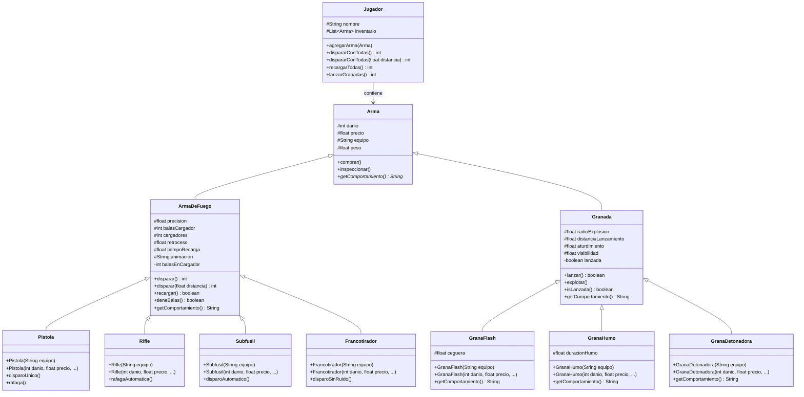
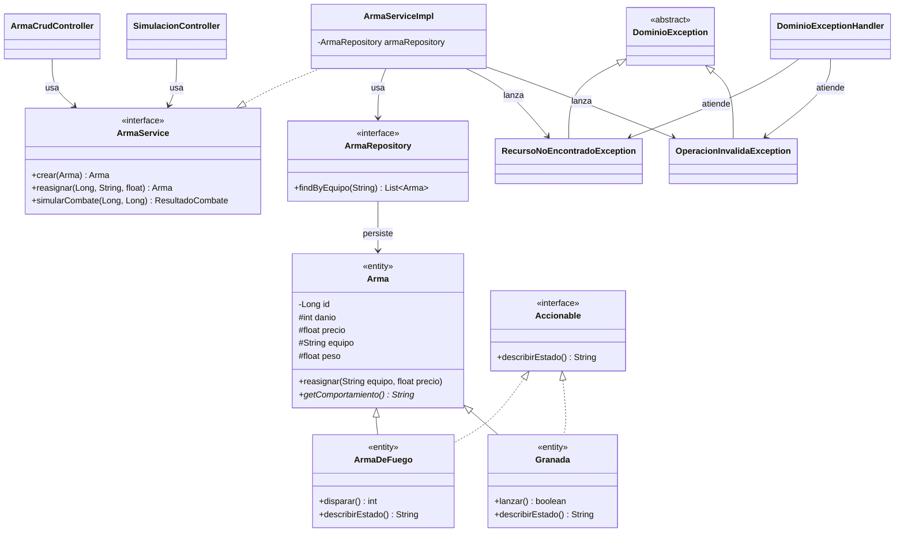

# LT-taller-git-2026

API REST de modelado de armas de Counter-Strike 2, implementada con Spring Boot. Demuestra herencia, sobreescritura, sobrecarga, ocultamiento de la información, persistencia en H2, CRUD REST, un protocolo de dominio y una jerarquía de excepciones.

## Entrega

- **Commit de la solución (POO-08 — CRUD, H2, Insomnia):** https://github.com/LTP22/ltauber-tp-lp3-2026/commit/02b097f
- **Commit de la solución (POO-06 — paquetes y constructores):** https://github.com/LTP22/ltauber-tp-lp3-2026/commit/0e476bcff2e6a45e3d798413362c29c4326f3ab5
- **Bitácora de IA:** [BITACORA.md](BITACORA.md)
- **Especificaciones (POO-08):** [ESPECIFICACIONES-POO-08.md](ESPECIFICACIONES-POO-08.md)
- **Commit de las especificaciones (POO-08):** https://github.com/LTP22/ltauber-tp-lp3-2026/commit/dc069db
- **Especificaciones (POO-06):** [ESPECIFICACIONES.md](ESPECIFICACIONES.md)
- **Colección de Insomnia:** [insomnia/CS2-POO08-Insomnia.json](insomnia/CS2-POO08-Insomnia.json)

## Objetivo

Publicar un servicio HTTP que versiona el modelado de clases de CS2, separa las reglas del dominio (`domain`) de la capa HTTP (`rest.controller`), y persiste una familia de esas clases en una base H2 con un CRUD REST completo, una simulación de combate y una jerarquía de excepciones propia.

## Estructura de paquetes

Sigue el template de la cátedra (`py.edu.uc.lp3`), con los paquetes nuevos de POO-08 (`repository`, `service`, `service.impl`, `domain.exception`):

```
py.edu.uc.lp3
├── Application                 arranque de Spring Boot
├── domain                      reglas del juego (Arma, Granada, Jugador, ...) y la interfaz Accionable
│   └── exception                DominioException, RecursoNoEncontradoException, OperacionInvalidaException
├── repository                  ArmaRepository (Spring Data JPA)
├── service                     ArmaService (interfaz) y ResultadoCombate
│   └── impl                     ArmaServiceImpl
└── rest.controller              servicios REST (IndexController, ArmaController, JugadorController,
    │                            ArmaCrudController, SimulacionController, DominioExceptionHandler)
    └── dto                      ArmaRequest, ReasignacionRequest (DTOs de transporte, no son dominio)
```

## Arquitectura

### Jerarquía de clases



### Persistencia, protocolo y excepciones (POO-08)

Diagrama aparte para no saturar el anterior. Muestra la familia persistida (`Arma` + sus dos hijas directas), el protocolo `Accionable`, el repositorio, los controllers nuevos y la jerarquía de excepciones. Las flechas distinguen herencia (`<|--`), implementación de interfaz (`<|..`) y uso/dependencia (`-->`):



## Sobreescritura y sobrecarga

### Sobreescritura

`Arma` declara el método abstracto `getComportamiento()`. Cada rama lo implementa con la misma firma y su propio cuerpo:

| Clase | Qué se agregó | Comportamiento devuelto |
|---|---|---|
| `Arma` | Método abstracto `getComportamiento()` | (contrato) |
| `ArmaDeFuego` | Implementación para la rama de armas de fuego | "Dispara con precision X y retroceso Y." |
| `Granada` | Implementación para la rama de granadas | "Se lanza a Xm y explota con radio Ym." |
| `GranaFlash`, `GranaHumo`, `GranaDetonadora` | Sobreescriben `getComportamiento()` de `Granada` | Texto específico de cada granada |

Se distingue por la firma idéntica y el cuerpo distinto. Cuál se ejecuta lo decide el tipo real del objeto en tiempo de ejecución: `ArmaController` declara `Arma`, pero devuelve `Pistola`, `GranaFlash`, etc.

### Sobrecarga

La sobrecarga usa el mismo nombre con distinta lista de parámetros. El compilador elige la versión según los argumentos.

| Clase | Sobrecarga | Diferencia |
|---|---|---|
| `Pistola`, `Rifle`, `Subfusil`, `Francotirador` | `(String equipo)` y `(int danio, float precio, ...)` | Constructor simple con valores legales por defecto, o completo con todos los atributos |
| `GranaFlash`, `GranaHumo`, `GranaDetonadora` | Igual que las armas de fuego | Idem |
| `ArmaDeFuego` | `disparar()` y `disparar(float distancia)` | Sin distancia equivale a disparar a quemarropa; con distancia el daño baja |
| `Jugador` | `dispararConTodas()` y `dispararConTodas(float distancia)` | Dispara todas las armas de fuego con balas, con o sin distancia |

Los constructores completos llaman a `super(...)` para inicializar la clase padre.

### Reglas del dominio

- Los constructores lanzan `IllegalArgumentException` con valores fuera de rango (daño negativo, equipo distinto de `T`/`CT`, precisión fuera de `[0, 1]`, cargador sin balas, etc.).
- `ArmaController` y `JugadorController` responden `400 Bad Request` con el motivo en el campo `error`.
- No hay setters públicos. El estado cambia solo por mensajes: `disparar()` consume una bala, `recargar()` gasta un cargador, `lanzar()` consume la granada.

## Persistencia en H2

`application.properties`, con lo que hace cada propiedad:

| Propiedad | Qué hace |
|---|---|
| `spring.datasource.url=jdbc:h2:mem:cs2db;DB_CLOSE_DELAY=-1` | Base en memoria llamada `cs2db`. `DB_CLOSE_DELAY=-1` evita que H2 la cierre cuando el pool libera la primera conexión (Spring abre y cierra conexiones todo el tiempo). |
| `spring.datasource.driverClassName=org.h2.Driver` | Driver JDBC de H2. |
| `spring.datasource.username` / `password` | Usuario `sa` sin contraseña, el que trae H2 por defecto. |
| `spring.jpa.hibernate.ddl-auto=create-drop` | Hibernate crea el esquema al arrancar y lo descarta al apagar. Tiene sentido porque la base es efímera: no hay datos que preservar entre corridas. |
| `spring.h2.console.enabled=true` + `spring.h2.console.path=/h2-console` | Habilita la consola web de H2 en `http://localhost:8080/h2-console` para poder abrir la base y mirar la tabla `ARMA` mientras el servicio corre (JDBC URL: `jdbc:h2:mem:cs2db`, usuario `sa`, sin contraseña). |

**Si mañana cambiamos H2 por otra base:** solo tocan `application.properties` (URL, driver, usuario) y la dependencia del driver en `pom.xml`. Las entidades, `ArmaRepository` (es una interfaz, Spring Data genera el código para cualquier motor relacional) y los controllers quedan intactos, porque dependen de JPA, no de H2 directamente.

## Protocolo de dominio: interfaz `Accionable`

```java
public interface Accionable {
    String describirEstado();
}
```

La implementan `ArmaDeFuego` y `Granada` —las dos ramas de la familia persistida—, cada una con su propia noción de "estado": cuántas balas le quedan a una, si la otra ya fue lanzada. El endpoint `GET /armas/{id}/estado` le pide el estado al objeto a través del tipo `Accionable`, sin preguntar nunca si es un arma de fuego o una granada.

## Reglas de negocio y simulación de combate

Dos reglas del juego, implementadas como métodos del dominio (no improvisadas en el controller):

1. **Disparar (daño/munición):** `ArmaDeFuego.disparar()` consume una bala del cargador actual y calcula el daño con la precisión del arma; sin balas, no dispara.
2. **Lanzar granada:** `Granada.lanzar()` marca la granada como usada; una granada ya lanzada no puede volver a lanzarse.

`POST /simulaciones/combate?armaDeFuegoId={id}&granadaId={id}` dispara las dos reglas sobre una `ArmaDeFuego` y una `Granada` ya persistidas, y guarda el resultado (`armaDeFuego.save(...)`, `granada.save(...)`). Las tres clases de la familia participan: el repositorio trabaja con el tipo `Arma`, y la simulación opera sobre instancias concretas de `ArmaDeFuego` y `Granada`. Un `GET /armas/{id}` posterior muestra el estado ya persistido (menos balas en el cargador, `lanzada: true`).

## Jerarquía de excepciones

```
DominioException (abstracta, RuntimeException)
├── RecursoNoEncontradoException   → 404, el id no existe en la base
└── OperacionInvalidaException     → 409, el recurso existe pero la operación rompe una regla de juego
```

`DominioExceptionHandler` (`@RestControllerAdvice`) tiene un `@ExceptionHandler` por tipo, así que el cliente distingue a las hermanas por el código HTTP y por el JSON. Es unchecked (`RuntimeException`) para que Spring la intercepte sin forzar un `try/catch` en cada método del service: son reglas de negocio rotas, no condiciones que el llamador pueda resolver ahí mismo.

**¿Quién lanza la excepción, el controller o el objeto del juego?** Ninguno de los dos directamente: `ArmaDeFuego.disparar()` y `Granada.lanzar()` siguen devolviendo un resultado silencioso (`0` balas, `false`) como en POO-06, para no romper las pruebas unitarias que ya dependían de ese contrato. Quien decide convertir esa imposibilidad en una excepción del dominio es `ArmaServiceImpl`: es la capa que conoce tanto el repositorio (sabe si el id existe) como el dominio (sabe cuándo una regla se rompió), así que es la única que tiene el contexto completo para decidirlo.

## Endpoints

### IndexController
- `GET /` — Confirma que el servicio está vivo.

### ArmaController
Construye la instancia desde los parámetros de la URL. Todos los parámetros son opcionales y tienen valor por defecto.

- `GET /arma/pistola?danio=25&precio=500&equipo=T&precision=0.75&...`
- `GET /arma/rifle?danio=77&precio=2100&...`
- `GET /arma/subfusil?danio=20&precio=1200&...`
- `GET /arma/francotirador?danio=115&precio=4750&...`
- `GET /arma/granada-flash?danio=0&precio=200&...`
- `GET /arma/granada-humo?danio=0&precio=300&...`
- `GET /arma/granada-detonadora?danio=60&precio=400&...`

Ejemplo de respuesta con un valor inválido:

```
GET /arma/pistola?danio=-5  →  400  {"error":"El daño no puede ser negativo"}
```

### JugadorController
El inventario es en memoria. Los IDs son `1`, `2`, ... en orden de creación.

- `POST /jugador?nombre=Luis` — Crea un jugador.
- `POST /jugador/{id}/agregar-arma?tipo=pistola` — Agrega un arma. Tipos: `pistola`, `rifle`, `subfusil`, `francotirador`, `granada-flash`, `granada-humo`, `granada-detonadora`.
- `GET /jugador/{id}` — Muestra el inventario con el estado de cada arma.
- `POST /jugador/{id}/disparar` — Dispara todas las armas de fuego con balas.
- `POST /jugador/{id}/disparar?distancia=50` — Igual, pero aplicando la distancia (sobrecarga).
- `POST /jugador/{id}/recargar` — Recarga las armas de fuego.
- `POST /jugador/{id}/lanzar-granadas` — Lanza las granadas que todavía no se usaron.

### ArmaCrudController — CRUD persistido en H2

El recurso es `/armas` (plural, distinto del catálogo `/arma/{tipo}` singular de arriba, que no toca la base). El JSON de creación discrimina el subtipo con el campo `tipo` (`armaDeFuego` o `granada`); el JSON de lectura lo agrega automáticamente según la clase real del objeto.

| Verbo | URL | Qué hace |
|---|---|---|
| `POST` | `/armas` | Crea un `ArmaDeFuego` o una `Granada` según `tipo`. Devuelve `201` con el `id` asignado por H2 (el cliente nunca lo manda). |
| `GET` | `/armas` | Lista lo persistido, leído del repositorio (no una lista armada en el método). |
| `GET` | `/armas/{id}` | Un ítem, o `404` (`RecursoNoEncontradoException`). |
| `PUT` | `/armas/{id}` | Reasigna **solo** `equipo` y `precio` (ver "Qué hay que pensar" más abajo). |
| `DELETE` | `/armas/{id}` | Borra el ítem. `204` si existía, `404` si no. |
| `GET` | `/armas/{id}/estado` | Usa el tipo `Accionable`: devuelve el estado del arma sin importar si es de fuego o granada. |

Ejemplo de creación y de error de validación:

```
POST /armas  {"tipo":"armaDeFuego","danio":25,"precio":500,"equipo":"T","peso":1.5,"precision":0.75,"balasCargador":12,"cargadores":3,"retroceso":0.3,"tiempoRecarga":0.5,"animacion":"pistol_fire"}
→ 201 {"id":1,"danio":25,...,"tipo":"armaDeFuego","balasEnCargador":12,...}

POST /armas  {"tipo":"armaDeFuego","danio":-5,...}
→ 400 {"error":"El daño no puede ser negativo"}

GET /armas/9999
→ 404 {"error":"No existe un arma con id 9999"}
```

### SimulacionController

- `POST /simulaciones/combate?armaDeFuegoId={id}&granadaId={id}` — Aplica las dos reglas de negocio (ver más arriba) y persiste el resultado. Si el arma no tiene balas o la granada ya fue lanzada, responde `409` (`OperacionInvalidaException`).

```
POST /simulaciones/combate?armaDeFuegoId=1&granadaId=2
→ 200 {"danioInfligido":19,"balasRestantes":11,"granadaLanzada":true}

POST /simulaciones/combate?armaDeFuegoId=1&granadaId=2   (de nuevo, misma granada)
→ 409 {"error":"La granada con id 2 ya fue lanzada"}
```

## Qué hay que pensar

Respuestas aplicadas a este dominio:

- **Recurso y verbo:** el sustantivo es `arma` (`/armas`); el verbo HTTP dice la operación (POST crea, GET lee, PUT reasigna, DELETE borra).
- **Identidad:** `Long id`, autogenerado por H2 (`GenerationType.IDENTITY`). El JSON de creación lo omite; el servidor lo asigna y lo devuelve.
- **Herencia y tablas:** `SINGLE_TABLE` con `@DiscriminatorColumn(name = "tipo")`. La familia es chica (tres clases), así que evitamos JOINs para un CRUD simple; el costo es columnas nulas para los atributos exclusivos de cada hija (una fila de `ArmaDeFuego` no usa `radioExplosion`, por ejemplo).
- **Interfaz y repositorio:** el controller depende de `ArmaService`, que depende de `ArmaRepository`: ambos son interfaces. Spring Data genera la implementación del repositorio en tiempo de arranque, igual que con `Accionable`: el código cliente habla con un tipo abstracto, no con los detalles concretos.
- **Protocolo del dominio:** `Accionable.describirEstado()`. Lo usa `GET /armas/{id}/estado`, y sí puede hablar con instancias de las dos ramas (`ArmaDeFuego` y `Granada`) sin distinguirlas.
- **Ocultamiento:** las reglas numéricas las sostiene cada clase en su constructor y en sus métodos (`disparar()`, `lanzar()`, `reasignar()`); no hay setters públicos. La prueba 07 de Insomnia (POST con `danio` negativo) muestra que un `POST` ilegal responde `400` y no se refleja en el siguiente `GET /armas` (la colección no creció).
- **PUT y PATCH:** el PUT implementado reemplaza un subconjunto de campos (`equipo`, `precio`), no el arma entera. Decidimos no reemplazar todo el recurso porque el resto de los atributos (daño, precisión, balas por cargador...) son intrínsecos al arma: dejarlos editables por un PUT genérico permitiría, por ejemplo, convertir una pistola en un arma que hace 1000 de daño sin pasar por ningún constructor. Si hace falta cambiar esos campos, se borra y se crea de nuevo.
- **DELETE:** borrar significa sacar el arma del catálogo persistido. No hay soft-delete porque no hay un rastro histórico que conservar a este nivel.
- **Dos reglas:** ver "Reglas de negocio y simulación de combate" más arriba.
- **Excepciones:** ver "Jerarquía de excepciones" más arriba. Un recurso inexistente (`RecursoNoEncontradoException`, 404) y una regla de juego incumplida (`OperacionInvalidaException`, 409) son tipos distintos a propósito: el primero significa "no hay nada que validar, no existe"; el segundo, "existe, pero esto que pedís rompe una regla". El JSON de error siempre trae `{"error": "<mensaje>"}`; lo que cambia es el código HTTP.

## Colección de Insomnia

Archivo: [`insomnia/CS2-POO08-Insomnia.json`](insomnia/CS2-POO08-Insomnia.json).

**Importar:** Insomnia → `Create` → `Import From File` → elegir el archivo. Trae un workspace con un `Base Environment` (`base_url`, y variables `arma_id` / `granada_id` / `arma_a_borrar_id` / `id_inexistente` para reutilizar entre pedidos) y 13 pedidos numerados.

**Orden de ejecución** (el número en el nombre de cada pedido es ese orden):

1. **01, 02, 03** — crean un arma de fuego, una granada y una tercera arma (para el DELETE). Copiar cada `id` de la respuesta a la variable del entorno correspondiente (`arma_id`, `granada_id`, `arma_a_borrar_id`).
2. **04, 05** — listan y leen por id, para confirmar que lo creado se persistió.
3. **06** — actualiza (`PUT`) equipo y precio del arma.
4. **07** — `POST` ilegal (`danio` negativo) → `400`.
5. **08** — endpoint de la interfaz `Accionable`.
6. **09** — simulación de combate, caso feliz: cumple las dos reglas.
7. **10** — `GET` a un id inexistente → `404` (`RecursoNoEncontradoException`).
8. **11** — repite la simulación con la misma granada → `409` (`OperacionInvalidaException`): la excepción hermana, con otro código y otro mensaje.
9. **12, 13** — `DELETE` del arma creada en el paso 3, y un `GET` posterior que confirma `404`.

## Polimorfismo en acción

El controller declara variables de tipo `Arma`, pero construye instancias concretas. El campo `comportamiento` del JSON sale del método sobreescrito de cada clase:

```json
{
  "danio": 25,
  "precio": 500.0,
  "equipo": "T",
  "peso": 1.5,
  "precision": 0.75,
  "balasCargador": 12,
  "balasEnCargador": 12,
  "cargadores": 3,
  "retroceso": 0.3,
  "tiempoRecarga": 0.5,
  "animacion": "pistol_fire",
  "comportamiento": "Dispara con precision 0.75 y retroceso 0.3."
}
```

## Conceptos implementados

- **Abstracción**: `Arma` y `Granada` son clases abstractas. `Arma` define el contrato `getComportamiento()`.
- **Herencia**: dos ramas independientes (`ArmaDeFuego`, `Granada`) y subclases concretas. Ahora también es una jerarquía JPA (`@Inheritance(SINGLE_TABLE)`).
- **Sobreescritura**: `getComportamiento()` se implementa en cada rama y en las granadas específicas.
- **Sobrecarga**: constructores simples y completos; `disparar()` y `dispararConTodas()` con y sin distancia.
- **Encapsulamiento**: atributos `protected` en las clases base y `private` en el estado mutable; sin setters públicos. El constructor vacío que exige JPA es `protected`, no `public`: solo Hibernate puede saltarse las validaciones, instanciando por reflexión.
- **Validación**: los constructores rechazan estados ilegales.
- **Protocolo de dominio (POO-07)**: interfaz `Accionable`, implementada por `ArmaDeFuego` y `Granada`.
- **Persistencia (POO-08)**: `Arma`/`ArmaDeFuego`/`Granada` se guardan en H2 vía `ArmaRepository` (Spring Data JPA).
- **Jerarquía de excepciones (POO-08)**: `DominioException` → `RecursoNoEncontradoException` (404) / `OperacionInvalidaException` (409), con un handler por tipo.

## Ejecución

1. Clonar el repositorio:
   ```bash
   git clone https://github.com/LTP22/ltauber-tp-lp3-2026.git
   cd ltauber-tp-lp3-2026
   ```

2. Ejecutar las pruebas y arrancar el servicio:
   ```bash
   ./mvnw test
   ./mvnw spring-boot:run
   ```

3. Probar los endpoints (en otra terminal; en PowerShell usar `curl.exe`, porque `curl` es un alias de `Invoke-WebRequest`):
   ```bash
   curl.exe http://localhost:8080/
   curl.exe http://localhost:8080/arma/pistola
   curl.exe -X POST "http://localhost:8080/jugador?nombre=Luis"
   curl.exe -X POST http://localhost:8080/armas -H "Content-Type: application/json" -d "{\"tipo\":\"armaDeFuego\",\"danio\":25,\"precio\":500,\"equipo\":\"T\",\"peso\":1.5,\"precision\":0.75,\"balasCargador\":12,\"cargadores\":3,\"retroceso\":0.3,\"tiempoRecarga\":0.5,\"animacion\":\"pistol_fire\"}"
   curl.exe http://localhost:8080/armas
   ```

4. O importar la [colección de Insomnia](insomnia/CS2-POO08-Insomnia.json) y recorrer los pedidos en orden (ver más arriba).

> Nota: desde que `Arma` tiene `id` (para persistirse), el catálogo viejo `/arma/{tipo}` también muestra `"id":null` en el JSON — esas instancias nunca se guardan en H2, por eso el id queda vacío. No es un error: es el mismo campo heredado, en un objeto que no pasó por el repositorio.

## Tecnologías

- **Java 21**
- **Spring Boot 4.1.1** (Spring Web, Spring Data JPA)
- **H2** (base en memoria)
- **Maven**
- **Insomnia** (cliente REST, colección versionada en `insomnia/`)

## Colaboración

Este proyecto fue desarrollado en colaboración con:

- **[agaona (ferue)](https://github.com/ferue)** — Desarrolló el sistema de tienda e inventario de venta en la rama `ltauber-contribucion-lp3` ([PR](https://github.com/ferue/agaona-taller-git-2026/pull/new/ltauber-contribucion-lp3))

La colaboración demuestra los principios de trabajo en equipo usando Git:
- Clonación de repositorios
- Creación de ramas de contribución
- Pull Requests para revisión de código
- Polimorfismo mediante `getComportamiento()`: `ArmaController` y `ArmaCrudController` arman la respuesta sin preguntar el tipo concreto del arma. `Jugador.dispararConTodas()` y `recargarTodas()` sí usan `instanceof ArmaDeFuego`/`Granada` para filtrar qué armas del inventario responden a cada acción (no todo `if` desaparece: hace falta donde una lista mixta debe separar por capacidad, no por comportamiento). El endpoint `/armas/{id}/estado` de POO-08, en cambio, sí evita ese `instanceof`: usa la interfaz `Accionable`.

---

**Proyectos relacionados:**
- [ltauber-tp-lp3-2026](https://github.com/LTP22/ltauber-tp-lp3-2026) (este proyecto)
- [agaona-taller-git-2026](https://github.com/ferue/agaona-taller-git-2026) (repo del compañero)

## Licencia

Apache License 2.0

---

Entrega del Taller Git 2026 - Programación Orientada a Objetos (LP3)
Universidad Católica - Facultad de Ciencias y Tecnología
